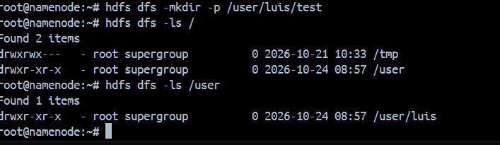
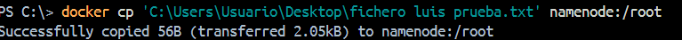
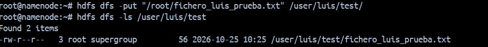
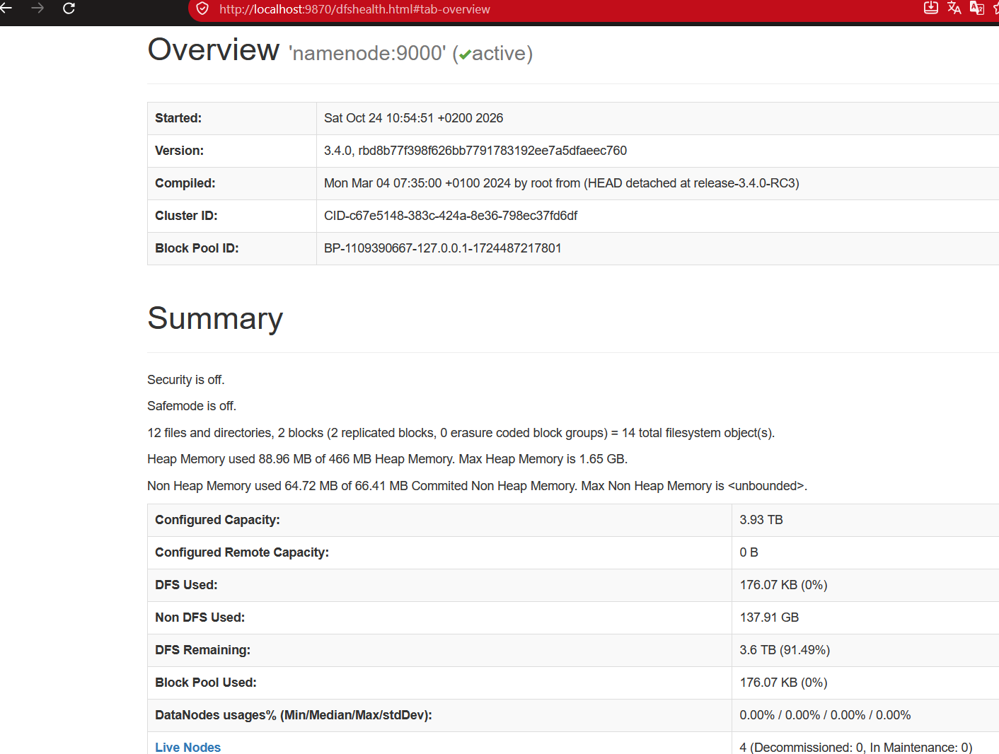

**:arrow_left: [Volver atras](../index.md)**
## 1. Conexion y estado de los servicios

> A partir de aqui la practica la debo de realizar en docker, ya que por un fallo de la maquina virtual de AWS no me deja ejecutar los comandos para copiar archivos, posiblemente por falta de espacion en el disco

## 2. Prueba funcional en HDFS 
- Creacion de un directorio personal con el comando `hdfs dfs -mkdir -p /user/luis/test`

- Subida de un fichero de texto local con contenido personalizado
- 1. Primero lo subimos desde nuestro equipo al sistema de archivos de root dentro de docker con el comando `docker cp 'C:\Users\Usuario\Desktop\fichero_luis_prueba.txt' namenode:/root`

- 2. Segundo debemos de mover el archivo del directorio de root al sistema de archivos hdfs con el comando `hdfs dfs -put "/root/fichero_luis_prueba.txt" /user/luis/test/`

- 3. Tercero vamos a listar los archivos del directorio para comprobar que se ha movido correctamenete con el comando `hdfs dfs -ls /user/luis/test`

## 3. Interfaz web del NameNode

## 4. Verificacion de MapReduce
Ejecutamos el siguiente comando `hadoop jar $HADOOP_HOME/share/hadoop/mapreduce/hadoop-mapreduce-examples-3.4.0.jar pi 2 100`

Y deberiamos obtener un resultado parecido al siguiente

**:arrow_left: [Volver atras](../index.md)**