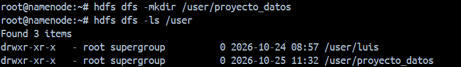
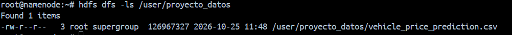
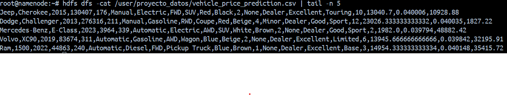
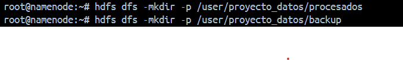
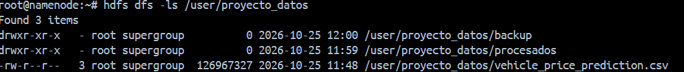
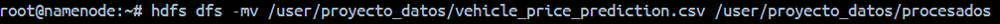
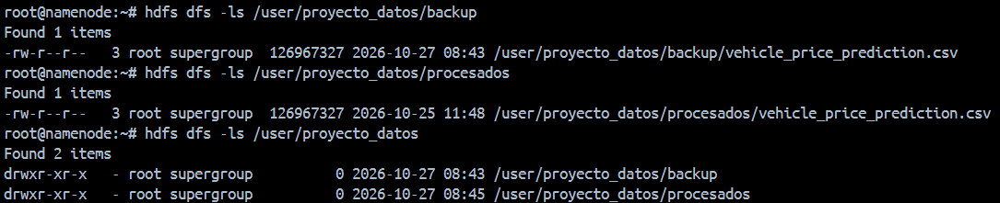
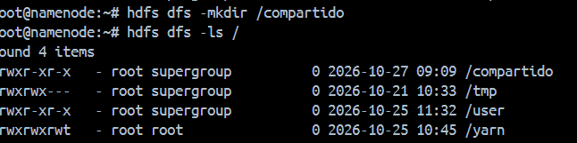
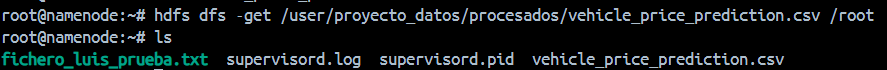
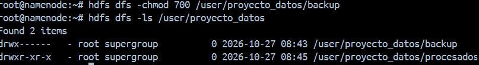

## 1. Preparacion del entorno
Creamos un directorio personal con el comando `hdfs dfs -mkdir /user/proyecto_datos` 

Y Comprobamos que se ha creado correctamente `hdfs dfs -ls /user`

## 2. Carga de datasets
Primero pasamos el archivo descargado desde nuestro sistema local al docker 

Ahora debemos de pasar desde al sistema de archivos de docker al directorio proyecto_datos `hdfs dfs -put "/root/vehicle_price_prediction.csv" /user/proyecto_datos`

Y comprobamos que se ha pasado correctamente `hdfs dfs -ls /user/proyecto_datos`

## 3. Exploracion de datos
Para comprobar el contenido del documento pondremos el comando `hdfs dfs -cat /user/proyecto_datos/vehicle_price_prediction.csv`

Para no visualizarlo entero y solo visualizar el final del documento o el principio debemos de poner `head -n x` o `tail -n x` siendo x el numero de lineas

## 4. Organizacion del proyecto
Creamos los dos directorios dentro de proyecto_datos con los comandos 

`hdfs dfs -mkdir -p /user/proyecto_datos/procesados`
`hdfs dfs -mkdir -p /user/proyecto_datos/backup`

Y comprobamos que se han creado correctamente`hdfs dfs -ls /user/proyecto_datos`

Ahora vamos a hacer una copia del archivo dentro del directorio backup `hdfs dfs -cp /user/proyecto_datos/vehicle_price_prediction.csv /user/proyecto_datos/backup`

Y moveremos el archivo dentro del directorio de procesados `hdfs dfs -mv /user/proyecto_datos/vehicle_price_prediction.csv /user/proyecto_datos/procesados`

Y por ultimo vamos a comprobar que todo se a realizado correctamente 
`hdfs dfs -ls /user/proyecto_datos/backup`
`hdfs dfs -ls /user/proyecto_datos/procesados`
`hdfs dfs -ls /user/proyecto_datos`

## 5. Colaboracion en el equipo
Crearemos el directioro compartido `hdfs dfs -mkdir /compartido`

## 6. Recuperacion de datos
Vamos a copiar el archivo a nuestro sistema de archivos local `hdfs dfs -get /user/proyecto_datos/procesados/vehicle_price_prediction.csv /root`

## 7. Control de accesos
Vamos a verificar los permisos con `hdfs dfs -ls /user/proyecto_datos`

Y tambien vamos a cambiar los permisos de backup y comprobar que esta bien `hdfs dfs -chmod 700 /user/proyecto_datos/backup`
