**:arrow_left: [Volver atras](../index.md)**

## 1. Preparación el espacio de trabajo en HDFS
Primero creamos el directorio principal con `hdfs dfs -mkdir -p /user/proyectos/ecommerce`.

Despues podremos crear el resto de directorios `hdfs dfs -mkdir -p /user/proyectos/ecommerce/{raw,procesados,backup}`.

Por ultimo comprobamos que se han creado correctamente todas las carpetas `hdfs dfs -ls -R /user/proyectos`.

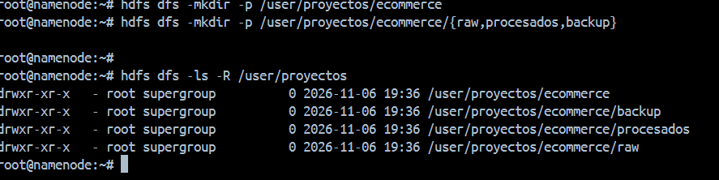

## 2. Carga inicial de logs
Primero vamos a descargarlos a nuestra maquina, para ello vamos a utilizar el comando 

`wget https://vgonzalez165.github.io/apuntes_bda/practicas/ut02/access_log_20251002-131938.log`

`wget https://vgonzalez165.github.io/apuntes_bda/practicas/ut02/access_log_20251002-131952.log`

`wget https://vgonzalez165.github.io/apuntes_bda/practicas/ut02/access_log_20251002-132005.log`

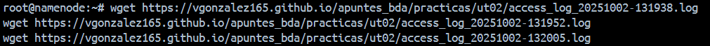

Ahora vamos a mover todos los archivos al directorio dentro de nuestro sistema de archivos hdfs con el comando 

`hdfs dfs -put access_log_20251002-131938.log access_log_20251002-131952.log access_log_20251002-132005.log /user/proyectos/ec   
ommerce/raw/`
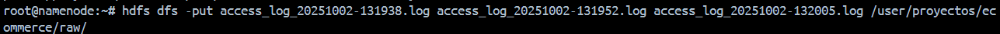

## 3. Inspección de datos
Ahora comprobamos que todos se han movido correctamente, vamos a listar los archivos `hdfs dfs -ls /user/proyectos/ecommerce/raw`
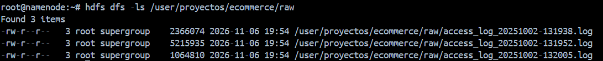

Ahora vamos a visualizar el contenido de uno de los archivos con el comando `hdfs dfs -cat /user/proyectos/ecommerce/raw/access_log_20251002-131938.log | head -n 5` con este comando podremos visualizar las primeras 5 lineas del archivo

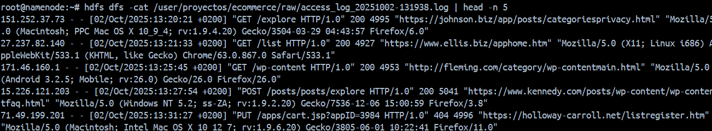

En el siguiente paso vamos a visualizar el numero de lineas que tiene cada archivo con el comando `hdfs dfs -cat /user/proyectos/ecommerce/raw/nombre_archivo | wc -l`

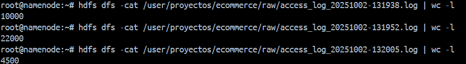

## 4. Organización de los logs
Ahora vamos a copiar todos los archivos con el comando `hdfs dfs -cp /user/proyectos/ecommerce/raw/*.log /user/proyectos/ecommerce/backup` y despues comprobaremos que se han copiado todos correctamente dentro de la ruta `hdfs dfs -ls /user/proyectos/ecommerce/backup`

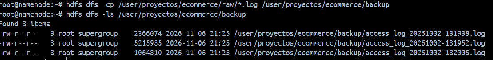 

El siguiente paso vamos a mover los archivos del directorio actual a **/procesados** con el comando`hdfs dfs -mv /user/proyectos/ecommerce/raw/*.log /user/proyectos/ecommerce/procesados`

Y acto seguido vamos a comprobar que se han movido correctamente con los comandos:

`hdfs dfs -ls /user/proyectos/ecommerce/procesados`

`hdfs dfs -ls /user/proyectos/ecommerce/raw`

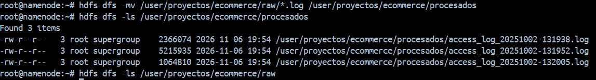

## 5. Acceso compartido para analistas

Primero vamos a comprobar los permisos en el directorio **/ecommerce**:

`hdfs dfs -ls -d /user/proyectos/ecommerce`

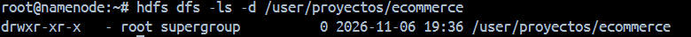

Ahora vamos a cambiar los permisos del directorio **/procesados** para que todos los usuarios solo tengan permisos de lectura pero no de escritura:

`hdfs dfs -chmod 555 /user/proyectos/ecommerce/procesados`

Y volvemos a comprobar los permisos

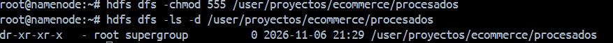

## 6. Simulacion de trabajo con analistas
Ahora vamos a descargar uno de los archivos del sistema de ficheros hdfs a nuestro sistema de ficheros local y comprobaremos que lo hemos desargado correctamente:

`hdfs dfs -get /user/proyectos/ecommerce/procesados/access_log_20251002-131938.log /tmp/`
`ls -lh /tmp/access_log_20251002-131938.log`

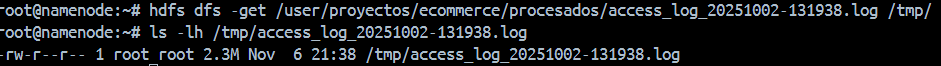

## 7. Mantenimiento y limpieza

Vamos a crear un archivo temporal en nuestro sistema de archivos temporal con el comando:

`echo "Archivo temporal de prueba" > prueba_luis_temp.txt` 

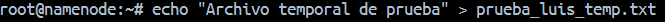

Vamos a moverlo a nuestro sistema de ficheros hdfs con el comando:

`hdfs dfs -put prueba_luis_temp.txt /user/proyectos/ecommerce/raw/`

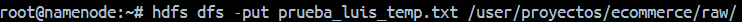

Comprobaremos que se ha movido correctamente:

`hdfs dfs -ls /user/proyectos/ecommerce/raw/`

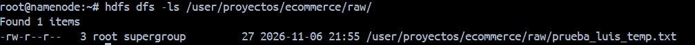

Ahora lo eliminaremos para mantener nuestro sistema de ficheros limpio con el comando:

`hdfs dfs -rm /user/proyectos/ecommerce/raw/prueba_luis_temp.txt`

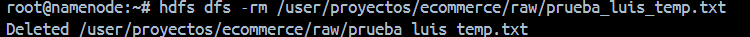

## 8. Configuracion de cuotas de espacio
Ahora vamos a configurar las cuotas de espacio con el comando:

`hdfs dfsadmin -setSpaceQuota 10m /user/proyectos/ecommerce/backup`

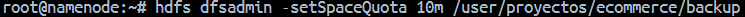

Ahora vamos a comprobar el estado de ocupacion frente a los limites:

`hdfs dfs -count -q -h /user/proyectos/ecommerce/backup`

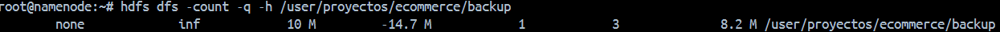

Ahora que vemos que se ha superado los limites establecidos vamos a intentar subir o mover un archivo a ese directorio a ver que es lo que pasa:

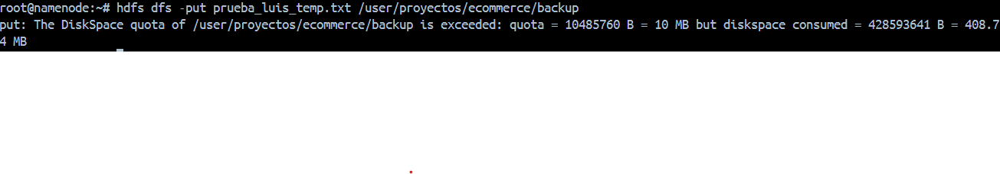

Como vemos nos pone un error relacionado con la cuota de espacio asignado ya que lo estamos superando y no nos deja realizar la operacion

**:arrow_left: [Volver atras](../index.md)**